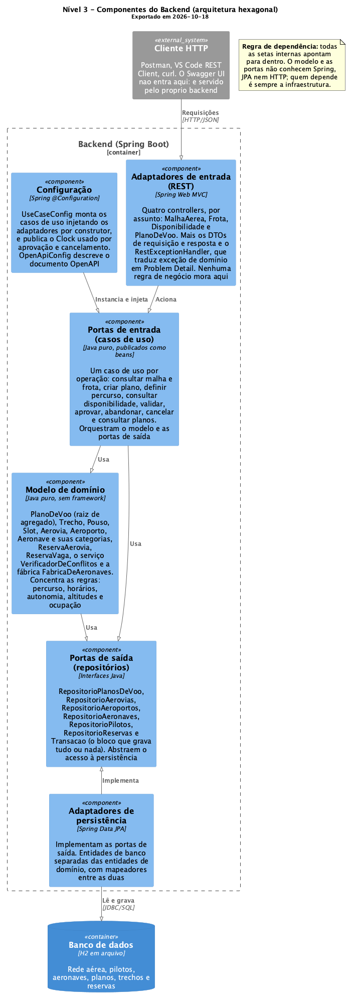

# Sistema de Gestão de Planos de Voo

Trabalho Final de Projeto e Arquitetura de Software — PUCRS, 2026/2. Parte 1 (monólito, tag
`parte-1`) evoluída na parte 2 para microsserviços, em quatro etapas (tags `etapa-1` a `etapa-4`).
Java 25, Spring Boot 4.1, Spring Cloud (Gateway e Eureka), RabbitMQ e H2.

Equipe: Antônio Costa, Gustavo Both, João Pedro Bianchi, Pedro Redivo e Vicenzo Masera.

## Serviços

| Serviço | Pasta | O que faz | Porta no host |
|---|---|---|---|
| gateway | `gateway/` | único ponto de entrada; `/gestao`, `/cadastro` e `/registro` | `127.0.0.1:8080` |
| eureka | `eureka/` | registro e descoberta das instâncias | `127.0.0.1:8761` (painel) |
| planos | `backend/` | pilotos, aeronaves, planos, reservas, disponibilidade e publicação das aprovações | — |
| cadastro | `cadastro/` | aeroportos, vagas e aerovias | — |
| registro | `registro/` | cópia de cada aprovação recebida pela fila | — |
| rabbitmq | imagem `rabbitmq:4.3.7-management` | fila das aprovações | `127.0.0.1:15672` (painel, guest/guest) |

Cada serviço de negócio tem seu próprio banco H2 em arquivo, num volume do Docker.

## Preparar e executar

Requer Docker com Compose v2. Não é preciso ter Java: o build das imagens compila e roda os testes.

```sh
docker compose up -d --build --wait --wait-timeout 900
docker compose ps        # todos healthy
```

O Compose sobe primeiro RabbitMQ e Eureka; gateway, planos, cadastro e registro esperam o Eureka
ficar saudável, e o registro também espera o RabbitMQ. Na primeira subida, cada serviço cria seu
schema e carrega seus dados iniciais; os planos aprovados da carga chegam ao registro pela fila em
poucos segundos.

| Comando | Efeito |
|---|---|
| `docker compose stop <serviço>` / `start <serviço>` | para e retoma um serviço (demonstrações de falha) |
| `docker compose down` | remove os contêineres e mantém os dados |
| `docker compose down -v` | apaga também os volumes; a próxima subida recarrega os dados iniciais |
| `docker compose logs -f planos` | log de um serviço |

Para rodar um serviço fora do Docker (desenvolvimento): `cd <pasta> && ./mvnw spring-boot:run`.
Ele procura o Eureka em `localhost:8761` e o RabbitMQ em `localhost`.

## Data de referência e relógio

**19/10/2026.** Os planos aprovados da carga ocupam 6 das 8 aerovias nesse dia (R1 e R3 ficam
livres). O plano 1005 partiu em 17/10 e mostra que um plano já executado não pode ser cancelado.

Cancelar depende da hora atual. Para a demonstração, fixe o relógio da gestão no dia de referência:

```sh
docker compose down -v
APP_RELOGIO_INSTANTE_FIXO=2026-10-19T10:00:00 docker compose up -d --build --wait --wait-timeout 900
```

Ou copie `.env.example` para `.env` e preencha `APP_RELOGIO_INSTANTE_FIXO`.

## Acessar a API

| | |
|---|---|
| Gestão de planos | http://localhost:8080/gestao |
| Cadastro (aeroportos e aerovias) | http://localhost:8080/cadastro — [contrato](docs/api/cadastro.md) |
| Aprovações registradas | http://localhost:8080/registro/aprovacoes — [mensagem](docs/api/mensagens.md) |
| Swagger UI | `http://localhost:8080/{gestao,cadastro,registro}/swagger-ui.html` |
| Roteiro de requisições | [`docs/api/requests.http`](docs/api/requests.http) |

As rotas `/gestao/planos` exigem o cabeçalho `X-Usuario` (401 sem ele); cada usuário só vê e
altera os próprios planos (403). Na carga inicial, os planos 1001 a 1005 pertencem a `carla`, `ana`,
`bruno`, `diego` e `bruno`.

Erros seguem o formato Problem Detail (RFC 7807), com `problemas` quando há mais de um:

| Situação | Status |
|---|---|
| Corpo ou parâmetro inválido | 400 |
| Sem `X-Usuario` | 401 |
| Plano de outro usuário | 403 |
| Recurso inexistente | 404 |
| Operação não permitida na situação do plano, ou registro duplicado | 409 |
| Regra de negócio violada ou plano não aprovável | 422 |
| Cadastro ou serviço de destino indisponível | 503 |

## Demonstração

- Parte 1 (regras dos planos): [`docs/roteiro-apresentacao.md`](docs/roteiro-apresentacao.md).
- Parte 2 (as 11 demonstrações do §7): tabela no fim de
  [`docs/arquitetura/evolucao-parte-2.md`](docs/arquitetura/evolucao-parte-2.md).

## Testes

```sh
cd backend && ./mvnw test     # também em cadastro/ e registro/
```

O CI roda os testes das cinco aplicações e confere que nenhum domínio importa Spring, JPA ou `infra`.

## Arquitetura

Cada serviço de negócio segue a arquitetura hexagonal (ports and adapters):

```
domain/
  model/        entidades e value objects
  exceptions/   exceções de negócio
  services/     implementam as portas de entrada
  ports/in/     interfaces *UseCase e commands
  ports/out/    interfaces *Repository, *Port
infra/
  adapters/in/rest/         controllers, dto/ e RestExceptionHandler
  adapters/in/messaging/    consumidor RabbitMQ (registro)
  adapters/out/persistence/ entity/, repository/, mapper/
  adapters/out/http/        cliente do cadastro (gestão)
  adapters/out/messaging/   publicador das aprovações (gestão)
  config/
```

## Documentação

- Modelos de domínio: [gestão](docs/dominio/modelo-dominio.puml),
  [cadastro](docs/dominio/modelo-cadastro.puml), [registro](docs/dominio/modelo-registro.puml)
- Casos de uso: [`docs/dominio/casos-de-uso.md`](docs/dominio/casos-de-uso.md)
- C4 (contexto, contêineres, componentes): [`docs/arquitetura/`](docs/arquitetura/)
- Decisões: [`docs/arquitetura/decisoes/`](docs/arquitetura/decisoes/)
- Evolução da parte 2, por etapa: [`docs/arquitetura/evolucao-parte-2.md`](docs/arquitetura/evolucao-parte-2.md)
- Contratos: [cadastro](docs/api/cadastro.md), [mensagem de aprovação](docs/api/mensagens.md)



