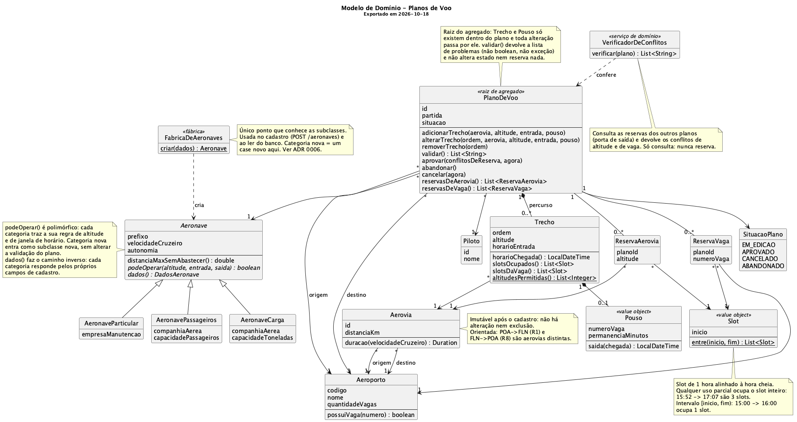
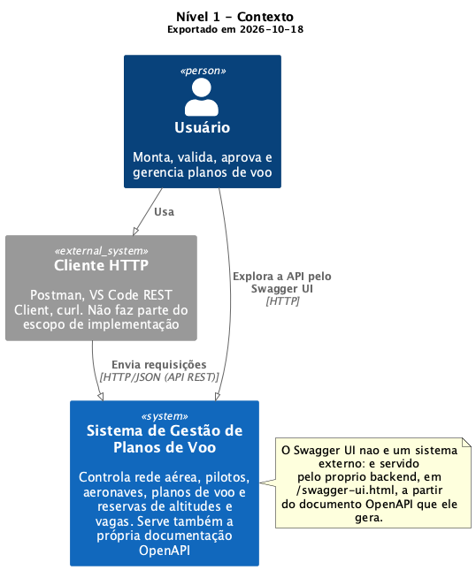
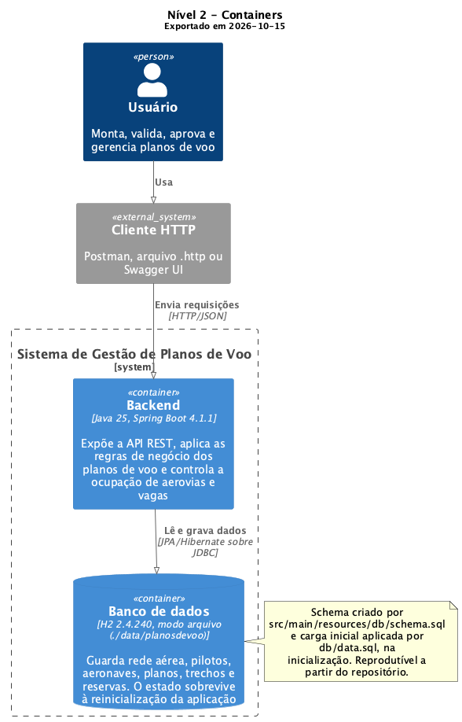
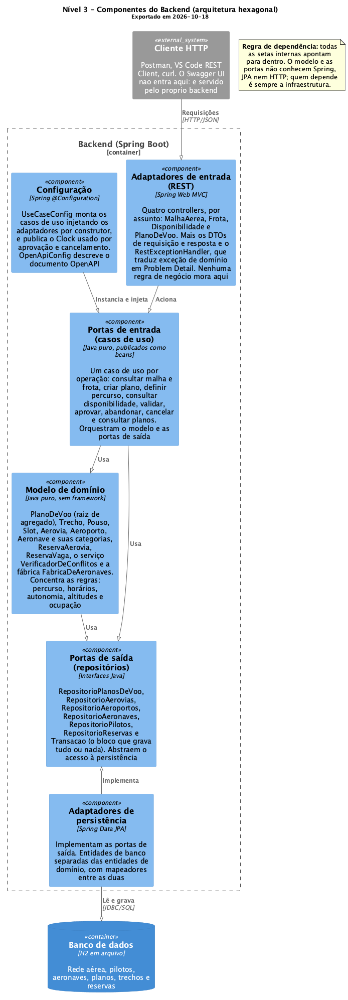

# Sistema de Gestão de Planos de Voo

Trabalho Final (parte 1) de **Projeto e Arquitetura de Software** — PUCRS,
turma 340, 2026/2. Backend em Java + Spring Boot, com API REST e persistência
em banco de dados.

O sistema permite montar um plano de voo trecho a trecho (aerovia, altitude,
horário de entrada e o que acontece no aeroporto de destino do trecho),
**verificar** se o percurso é contínuo, se os horários batem com a duração
calculada, se a aeronave pode operar naquela altitude e naquele horário, se a
autonomia aguenta e se altitude e vaga estão livres — e então **reservar** tudo
de uma vez e aprovar.

## Equipe

- Antônio Costa
- Gustavo Both
- João Pedro Bianchi
- Pedro Redivo
- Vicenzo Masera

## Data de referência

**19/10/2026.**

É a data usada nos testes de disponibilidade, conflito e reserva durante a
apresentação. A carga inicial traz **quatro planos já aprovados** voando nesse
dia, e as reservas deles ocupam altitudes de aerovias e vagas de aeroportos:
**6 das 8 aerovias** têm ocupação, acima do mínimo de 60% que o enunciado pede.

Dois desses planos partem de madrugada e de manhã (01:00 e 06:30) e dois à
noite (20:00 e 21:00). No dia da apresentação, os primeiros já partiram e
demonstram que um plano cuja partida ocorreu **não** é cancelável; os últimos
ainda são futuros e demonstram o cancelamento com liberação das reservas.

A R1 e a R3 ficam livres o dia inteiro de propósito, para que sempre haja
recurso disponível para demonstrar uma aprovação bem-sucedida.

## Ensaiar com o relógio fixo

Duas regras dependem da hora real: **cancelar** um plano exige que a partida
ainda não tenha ocorrido, e **aprovar**, também. Isso significa que as
demonstrações de cancelamento mudam de resultado conforme o dia em que são
feitas.

Para ensaiar a apresentação em qualquer data, suba a aplicação com o relógio
fixado no dia e hora que quiser:

```sh
cd backend
./mvnw spring-boot:run \
  -Dspring-boot.run.arguments=--app.relogio.instante-fixo=2026-10-19T10:00:00
```

Com isso o sistema acredita que são 10:00 de 19/10/2026: os planos da carga
inicial que partem de madrugada já partiram, e os da noite ainda não.

| Propriedade | Padrão | O que faz |
|---|---|---|
| `app.relogio.zona` | `America/Sao_Paulo` | fuso usado para o "agora" |
| `app.relogio.instante-fixo` | *(vazio)* | data e hora fixas, formato ISO. Vazio = relógio real |

Sem essas propriedades, o relógio é o real, no fuso de São Paulo — que é como a
aplicação roda por padrão.

**O que não depende do relógio:** o plano 1005 da carga inicial parte em
17/10, antes da data de referência, então ele já partiu em qualquer dia. É por
isso que a demonstração de cancelamento recusado funciona sem ajuste nenhum.

## Preparação do ambiente

Só é preciso ter **Java 25** instalado. O Maven vem junto, pelo wrapper
(`mvnw`), e o banco é embutido — não há Docker, serviço externo nem credencial
a configurar.

```sh
java -version   # precisa ser 25 ou superior
```

Se não tiver o Java 25: https://adoptium.net ou, no macOS,
`brew install openjdk@25`.

## Execução

```sh
cd backend
./mvnw spring-boot:run
```

A aplicação sobe em **http://localhost:8080**. O primeiro start demora mais,
porque o Maven baixa as dependências.

No Windows, use `mvnw.cmd` no lugar de `./mvnw`:

```bat
cd backend
mvnw.cmd spring-boot:run
```

Para compilar e rodar os testes:

```sh
cd backend
./mvnw clean test
```

### Primeira requisição, em dois minutos

Com a aplicação no ar, esta consulta mostra a ocupação que a carga inicial já
traz na data de referência — a altitude de 31.000 pés **não** aparece na lista,
porque um plano aprovado do seed a reservou:

```sh
curl "http://localhost:8080/aerovias/R2/altitudes-disponiveis?inicio=2026-10-19T21:00:00&fim=2026-10-19T23:00:00"
```

E esta mostra de onde veio essa ocupação:

```sh
curl http://localhost:8080/planos/1003
```

O roteiro completo, com as 17 demonstrações, está em
[`docs/api/requests.http`](docs/api/requests.http) e resumido em
[`docs/roteiro-apresentacao.md`](docs/roteiro-apresentacao.md).

### Se algo der errado

| Sintoma | O que fazer |
|---|---|
| `Web server failed to start. Port 8080 was already in use` | outra aplicação está na porta: `lsof -ti:8080 \| xargs kill` (no Windows, `netstat -ano \| findstr :8080` e `taskkill /PID <pid> /F`) |
| `release version 25 not supported` | o Java no `PATH` não é o 25: confira com `java -version` |
| `Database may be already in use` ou um `.lock.db` preso | a aplicação não encerrou direito: `rm -rf backend/data` (no Windows, `rmdir /s /q backend\data`) e suba de novo |
| As demonstrações de cancelamento não dão o resultado esperado | elas dependem da data: veja *Ensaiar com o relógio fixo* |

Para gerar o `.jar`:

```sh
cd backend
./mvnw clean package
java -jar target/planos-de-voo-0.0.1-SNAPSHOT.jar
```

## Banco e carga inicial

O banco é **H2 em modo arquivo**, gravado em `backend/data/planosdevoo.mv.db`.
É arquivo e não memória de propósito: o enunciado exige que as alterações
feitas pela API sobrevivam à reinicialização da aplicação.

Na inicialização, o Spring executa dois scripts versionados, nesta ordem:

| Script | O que faz |
|---|---|
| `backend/src/main/resources/db/schema.sql` | cria as tabelas, com chaves, índices e restrições |
| `backend/src/main/resources/db/data.sql` | carrega a malha aérea, os pilotos, as aeronaves e os planos aprovados com suas reservas |

O schema **não** é gerado pelo Hibernate (`spring.jpa.hibernate.ddl-auto=none`),
para que seja versionável e reproduzível. O `data.sql` usa `MERGE`, então rodar
a aplicação várias vezes não duplica os dados.

### Recomeçar do zero

```sh
cd backend
rm -rf ./data
./mvnw spring-boot:run
```

A carga inicial é reproduzível a partir deste repositório: não há nenhuma
inserção manual necessária antes da apresentação. O `data.sql` é conferido
contra o próprio domínio a cada build, pelo `SeedConsistenciaTest`: se uma linha
de reserva deixar de bater com o que a aprovação geraria, o build quebra.

### Inspecionar o banco

Console web do H2, com a aplicação no ar: **http://localhost:8080/h2-console**

| Campo | Valor |
|---|---|
| JDBC URL | `jdbc:h2:file:./data/planosdevoo` |
| Usuário | `sa` |
| Senha | *(em branco)* |

## API

URL base: **http://localhost:8080**

| O que | Onde |
|---|---|
| Swagger UI | http://localhost:8080/swagger-ui.html |
| Documento OpenAPI | http://localhost:8080/v3/api-docs |
| Roteiro de requisições | [`docs/api/requests.http`](docs/api/requests.http) |
| Roteiro da apresentação, as 17 demonstrações | [`docs/roteiro-apresentacao.md`](docs/roteiro-apresentacao.md) |

O `requests.http` cobre o ciclo completo de um plano e os casos de falha, na
ordem da apresentação, com o resultado esperado comentado em cada bloco. Abre
direto no VS Code (extensão REST Client) ou no IntelliJ.

Respostas de erro seguem o formato **Problem Detail** (RFC 7807), com a lista
de problemas quando há mais de um:

```json
{
  "status": 400,
  "title": "Bad Request",
  "detail": "Requisição inválida",
  "problemas": ["origem: must not be blank", "partida: must not be null"]
}
```

| Situação | Status |
|---|---|
| Consulta bem-sucedida | 200 |
| Criação de plano | 201 |
| Recurso inexistente | 404 |
| Operação não permitida no estado atual do plano | 409 |
| Corpo da requisição inválido | 400 |
| Regra de negócio violada | 422 |

### Endpoints

| Método | Rota | O que faz |
|---|---|---|
| `GET` | `/aeroportos` · `/aerovias` · `/pilotos` · `/aeronaves` | consultam a malha e a frota (UC01 a UC04) |
| `POST` | `/aeroportos` · `/aerovias` · `/pilotos` · `/aeronaves` | cadastram. Aerovia não tem `PUT` nem `DELETE`: é imutável |
| `GET` | `/aerovias/{id}/altitudes-disponiveis?inicio=&fim=` | altitudes livres no período (UC07) |
| `GET` | `/aeroportos/{codigo}/vagas-disponiveis?inicio=&fim=` | vagas livres no período (UC08) |
| `POST` | `/planos` | cria o plano, em edição (UC05) |
| `GET` | `/planos` · `/planos?situacao=` · `/planos/{id}` | consultam (UC13, UC14) |
| `POST` `PUT` `DELETE` | `/planos/{id}/trechos[/{ordem}]` | montam e alteram o percurso (UC06) |
| `POST` | `/planos/{id}/validacao` | valida sem alterar nada (UC09) |
| `POST` | `/planos/{id}/aprovacao` | aprova e reserva, tudo ou nada (UC10) |
| `POST` | `/planos/{id}/cancelamento` | cancela e libera as reservas (UC12) |
| `POST` | `/planos/{id}/abandono` | abandona um plano em edição (UC11) |

## Limitações conhecidas

São escolhas, não defeitos — e estão registradas em
[`docs/arquitetura/decisoes/0010-interpretacoes-do-enunciado.md`](docs/arquitetura/decisoes/0010-interpretacoes-do-enunciado.md):

- **A duração de cada trecho é arredondada ao minuto.** 363 km a 830 km/h dá 26
  min e 14 s, e o sistema usa 26 min. Sem isso, nenhum horário digitado pelo
  usuário bateria com a chegada calculada.
- **Cancelar e aprovar dependem do relógio**, porque as duas regras falam da
  partida ter ocorrido ou não. Para ensaiar em outra data, veja a seção
  *Ensaiar com o relógio fixo*.
- **Só o percurso é editável** depois de criado o plano. Trocar piloto, aeronave
  ou horário de partida exige criar outro plano — mudar a aeronave invalidaria
  todos os horários já calculados.
- **O console do H2 fica habilitado** em `/h2-console`. É conveniência de
  demonstração; num sistema real ele não iria para produção assim.
- **Não há autenticação.** O enunciado não pede, e a API é exposta apenas em
  `localhost`.

## Documentação

| O que | Onde |
|---|---|
| Modelo de domínio (UML) | [`docs/dominio/modelo-dominio.png`](docs/dominio/modelo-dominio.png) — abaixo |
| Casos de uso UC01–UC14 | [`docs/dominio/casos-de-uso.md`](docs/dominio/casos-de-uso.md) |
| Diagramas C4 (contexto, containers, componentes) | [`docs/arquitetura/`](docs/arquitetura/) — abaixo |
| Decisões arquiteturais (ADR) | [`docs/arquitetura/decisoes/`](docs/arquitetura/decisoes/) |
| Padrões de desenvolvimento | [`docs/padroes-desenvolvimento.md`](docs/padroes-desenvolvimento.md) |
| Plano de trabalho da equipe | [`docs/plano-de-trabalho.md`](docs/plano-de-trabalho.md) |
| Guia de contexto para ferramentas de IA (não faz parte da entrega) | [`CLAUDE.md`](CLAUDE.md) e `CONTEXT_NEW.md` |
| Enunciado | `PAS_TF_2026_2_PlanosDeVoo (1).md` |

Cada `.png` é exportado do `.puml` ao lado, que é a fonte versionada. A data de
exportação fica no rodapé da própria imagem, para flagrar diagrama defasado.

### Modelo de domínio



### C4 nível 1 — Contexto



### C4 nível 2 — Containers



### C4 nível 3 — Componentes do backend



## Arquitetura, em uma olhada

**Hexagonal (ports & adapters)**, documentada em **C4**. O domínio não conhece
Spring, JPA nem HTTP; quem depende é sempre a infraestrutura.

```
backend/src/main/java/com/pucrs/planosdevoo/
├── domain/
│   ├── model/              entidades e value objects — Java puro
│   └── ports/
│       ├── in/usecases/    casos de uso
│       └── out/repositories/ interfaces de repositório
└── infra/
    ├── adapters/
    │   ├── in/rest/        controllers e DTOs
    │   └── out/persistence/ entidades JPA e mapeadores
    └── config/             composição dos beans
```

A regra de dependência é verificável em uma linha — tem que devolver nada:

```sh
grep -rn "org.springframework\|jakarta.persistence\|infra\." \
  backend/src/main/java/com/pucrs/planosdevoo/domain/
```

As decisões por trás dessa organização, com as alternativas que foram
descartadas, estão em [`docs/arquitetura/decisoes/`](docs/arquitetura/decisoes/).
