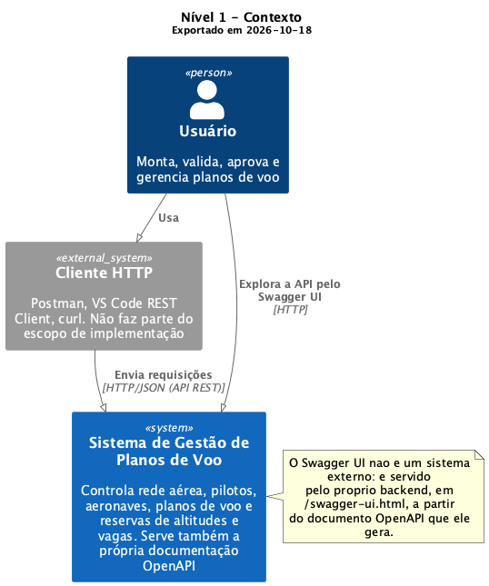

# Sistema de Gestão de Planos de Voo

Trabalho Final (parte 1) de Projeto e Arquitetura de Software — PUCRS, 2026/2.
Backend em Java 25 e Spring Boot, com API REST e banco H2.

Equipe: Antônio Costa, Gustavo Both, João Pedro Bianchi, Pedro Redivo e Vicenzo Masera.

## Data de referência

**19/10/2026.** A carga inicial traz planos aprovados que ocupam 6 das 8 aerovias nesse dia
(R1 e R3 ficam livres). O plano 1005 partiu em 17/10 e serve para mostrar que um plano já
executado não pode ser cancelado.

## Executar

Requer Java 25. O Maven vem pelo wrapper e o banco é embutido.

```sh
cd backend
./mvnw spring-boot:run      # Windows: mvnw.cmd spring-boot:run
./mvnw clean test
```

A API sobe em `http://localhost:8080`:

| | |
|---|---|
| Swagger UI | http://localhost:8080/swagger-ui.html |
| OpenAPI | http://localhost:8080/v3/api-docs |
| Console H2 | http://localhost:8080/h2-console (`jdbc:h2:file:./data/planosdevoo`, usuário `sa`, sem senha) |
| Roteiro de requisições | [`docs/api/requests.http`](docs/api/requests.http) |
| Roteiro da apresentação | [`docs/roteiro-apresentacao.md`](docs/roteiro-apresentacao.md) |

Para ensaiar a apresentação em outro dia, fixe o relógio:

```sh
./mvnw spring-boot:run -Dspring-boot.run.arguments=--app.relogio.instante-fixo=2026-10-19T10:00:00
```

## Banco e carga inicial

H2 em arquivo (`backend/data/`), então o estado sobrevive à reinicialização. Na subida, o
Spring executa `backend/src/main/resources/db/schema.sql` e `data.sql`. A carga usa `MERGE`,
então reiniciar não duplica dados nem desfaz cancelamentos. Para recomeçar do zero, apague
`backend/data/`.

## Arquitetura

Hexagonal (ports and adapters). O domínio não importa Spring, JPA nem `infra`, e o CI confere.

```
backend/src/main/java/com/pucrs/planosdevoo/
├── domain/
│   ├── model/        entidades e value objects
│   ├── exceptions/   exceções de negócio
│   ├── services/     MalhaAerea, Frota, Disponibilidade e PlanoDeVoo
│   └── ports/
│       ├── in/       interfaces *UseCase e commands
│       └── out/      interfaces *Repository e TransacaoPort
└── infra/
    ├── adapters/in/rest/              controllers, dto/ e RestExceptionHandler
    ├── adapters/out/persistence/      entity/, repository/, mapper/ e TransacaoSpringAdapter
    └── config/                        ServiceConfig e OpenApiConfig
```

## Erros da API

Problem Detail (RFC 7807), com `problemas` quando há mais de um.

| Situação | Status |
|---|---|
| Corpo ou parâmetro inválido | 400 |
| Recurso inexistente | 404 |
| Operação não permitida na situação do plano, ou registro duplicado | 409 |
| Regra de negócio violada ou plano não aprovável | 422 |

## Documentação

- Modelo de domínio: [`docs/dominio/modelo-dominio.puml`](docs/dominio/modelo-dominio.puml)
- Casos de uso: [`docs/dominio/casos-de-uso.md`](docs/dominio/casos-de-uso.md)
- C4 (contexto, contêineres, componentes): [`docs/arquitetura/`](docs/arquitetura/)
- Decisões: [`docs/arquitetura/decisoes/`](docs/arquitetura/decisoes/)





