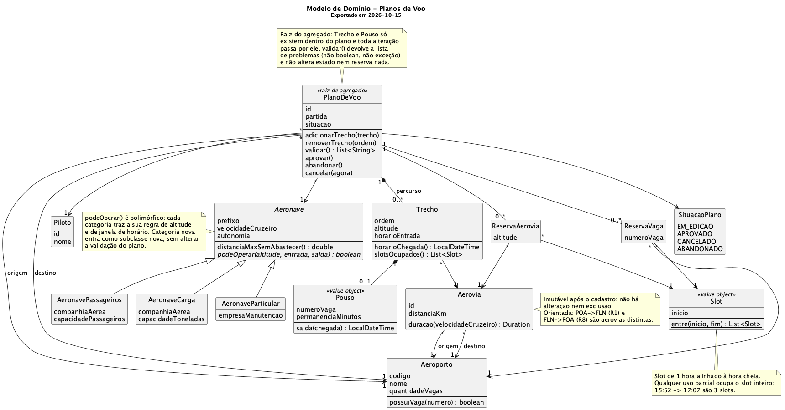
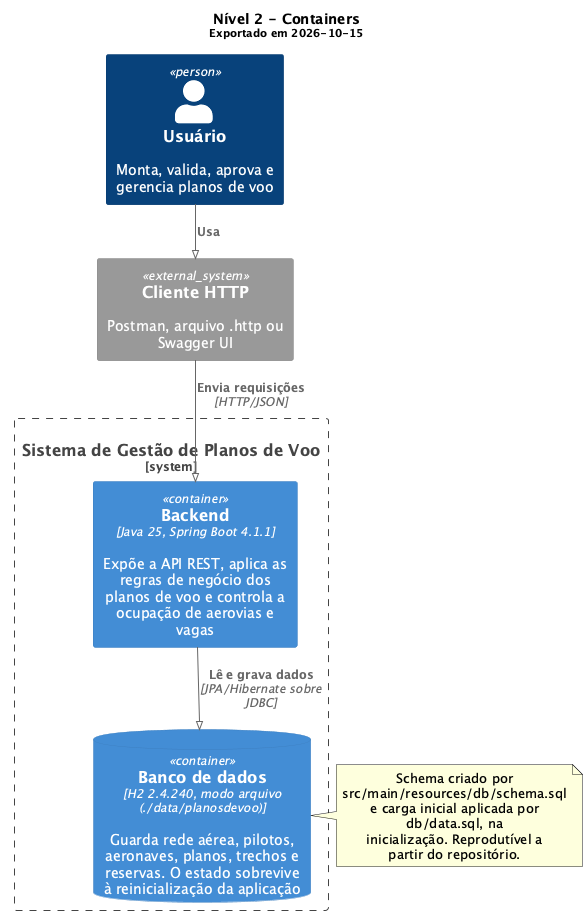

# Sistema de Gestão de Planos de Voo

Trabalho Final (parte 1) de Projeto e Arquitetura de Software — PUCRS, 2026/2.
Backend em Java 25 e Spring Boot, com API REST e banco H2.

Equipe: Antônio Costa, Gustavo Both, João Pedro Bianchi, Pedro Redivo e Vicenzo Masera.

## Data de referência

**19/10/2026.** A carga inicial traz planos aprovados que ocupam 6 das 8 aerovias nesse dia
(R1 e R3 ficam livres). O plano 1005 partiu em 17/10 e serve para mostrar que um plano já
executado não pode ser cancelado.

## Executar

Requer Java 25. O Maven vem pelo wrapper e o banco é embutido.

```sh
cd backend
./mvnw spring-boot:run      # Windows: mvnw.cmd spring-boot:run
./mvnw clean test
```

Com o `docker compose up`, o acesso é pelo gateway, em `http://localhost:8080/gestao`:

| | |
|---|---|
| API (gestão de planos) | http://localhost:8080/gestao |
| API do cadastro (aeroportos e aerovias) | http://localhost:8080/cadastro ([contrato](docs/api/cadastro.md)) |
| Aprovações registradas | http://localhost:8080/registro/aprovacoes ([mensagem](docs/api/mensagens.md)) |
| Painel do RabbitMQ | http://localhost:15672 (guest/guest) |
| Swagger UI | `/gestao`, `/cadastro` e `/registro` + `/swagger-ui.html` |
| Eureka | http://localhost:8761 |
| Roteiro de requisições | [`docs/api/requests.http`](docs/api/requests.http) |
| Roteiro da apresentação | [`docs/roteiro-apresentacao.md`](docs/roteiro-apresentacao.md) |

Rodando só o `backend/` com `./mvnw spring-boot:run`, a API fica direto em `http://localhost:8080`
(sem o prefixo) e o console H2 em `/h2-console` (`jdbc:h2:file:./data/planosdevoo`, usuário `sa`).

Para ensaiar a apresentação em outro dia, fixe o relógio:

```sh
./mvnw spring-boot:run -Dspring-boot.run.arguments=--app.relogio.instante-fixo=2026-10-19T10:00:00
```

## Executar com Docker

Requer Docker com Compose v2. O build da imagem roda os testes. Decisão em
[ADR 0009](docs/arquitetura/decisoes/0009-implantacao-em-conteineres.md).

```sh
docker compose up -d --build --wait --wait-timeout 300
docker compose ps
docker compose down       # mantém o volume com o banco
docker compose down -v    # apaga o volume; a próxima subida recarrega o seed
```

Para fixar o relógio, copie `.env.example` para `.env` e preencha `APP_RELOGIO_INSTANTE_FIXO`.

## Usuário

As rotas `/planos` exigem o cabeçalho `X-Usuario` (401 sem ele). Cada usuário só vê e altera os
próprios planos (403). Na carga inicial, os planos 1001 a 1005 pertencem a `carla`, `ana`, `bruno`,
`diego` e `bruno`.

## Banco e carga inicial

H2 em arquivo (`backend/data/`), então o estado sobrevive à reinicialização. Na subida, o
Spring executa `backend/src/main/resources/db/schema.sql` e `data.sql`. A carga usa `MERGE`,
então reiniciar não duplica dados nem desfaz cancelamentos. Para recomeçar do zero, apague
`backend/data/`.

## Arquitetura

Hexagonal (ports and adapters). O domínio não importa Spring, JPA nem `infra`, e o CI confere.

```
backend/src/main/java/com/pucrs/planosdevoo/
├── domain/
│   ├── model/        entidades e value objects
│   ├── exceptions/   exceções de negócio
│   ├── services/     MalhaAerea, Frota, Disponibilidade e PlanoDeVoo
│   └── ports/
│       ├── in/       interfaces *UseCase e commands
│       └── out/      interfaces *Repository e TransacaoPort
└── infra/
    ├── adapters/in/rest/              controllers, dto/ e RestExceptionHandler
    ├── adapters/out/persistence/      entity/, repository/, mapper/ e TransacaoSpringAdapter
    └── config/                        ServiceConfig e OpenApiConfig
```

## Erros da API

Problem Detail (RFC 7807), com `problemas` quando há mais de um.

| Situação | Status |
|---|---|
| Corpo ou parâmetro inválido | 400 |
| Recurso inexistente | 404 |
| Operação não permitida na situação do plano, ou registro duplicado | 409 |
| Regra de negócio violada ou plano não aprovável | 422 |

## Documentação

- Modelo de domínio: [`docs/dominio/modelo-dominio.puml`](docs/dominio/modelo-dominio.puml)
- Casos de uso: [`docs/dominio/casos-de-uso.md`](docs/dominio/casos-de-uso.md)
- C4 (contexto, contêineres, componentes): [`docs/arquitetura/`](docs/arquitetura/)
- Decisões: [`docs/arquitetura/decisoes/`](docs/arquitetura/decisoes/)
- Evolução da parte 2, por etapa: [`docs/arquitetura/evolucao-parte-2.md`](docs/arquitetura/evolucao-parte-2.md)





