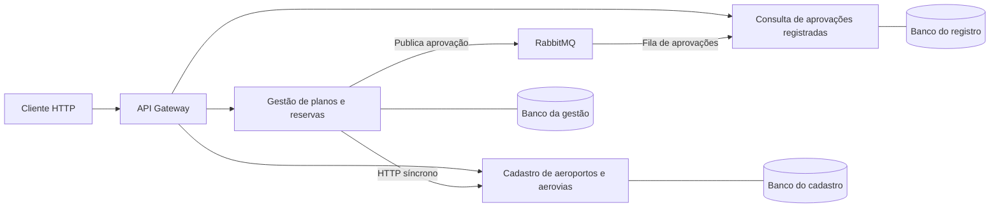

# Trabalho Final — Parte 2: evolução para microsserviços

## 1. Objetivo e continuidade do trabalho

Esta segunda parte dá continuidade ao **Sistema de Gestão de Planos de Voo** desenvolvido na primeira parte. O objetivo é evoluir a arquitetura existente, extraindo responsabilidades para microsserviços e introduzindo comunicação síncrona e assíncrona, com o menor impacto possível sobre as funcionalidades já implementadas.

As regras de percurso, horários, operação das aeronaves, autonomia, ocupação, validação, aprovação, abandono e cancelamento estabelecidas no enunciado da primeira parte continuam válidas, salvo os ajustes expressamente definidos neste documento.

A solução deverá continuar sendo um **backend Java/Spring Boot**, sem frontend obrigatório. A implementação e a demonstração deverão ocorrer progressivamente em **quatro etapas**, descritas na seção 4.

O foco da avaliação será a evolução arquitetural: isolamento de responsabilidades, contratos de integração, propriedade dos dados, preservação das regras e tratamento das consequências da distribuição do sistema.

## 2. Arquitetura pretendida e responsabilidades

Ao final, o sistema deverá conter três aplicações de negócio independentes, além da infraestrutura de integração.

### 2.1 Backend de gestão dos planos de voo

É a evolução do monólito da primeira parte. Permanecem sob sua responsabilidade:

- pilotos e aeronaves;
- criação, edição, consulta e validação dos planos;
- aprovação, abandono e cancelamento;
- controle de ocupação e disponibilidade de altitudes e vagas;
- efetivação e liberação de reservas;
- controle de propriedade e acesso aos planos;
- produção das mensagens que informam aprovações efetivadas.

O backend deixará de manter o cadastro mestre de aeroportos e aerovias. Passará a obter essas informações pela API HTTP do microsserviço de cadastro.

A aprovação continuará sendo uma operação local integral: **estado do plano e reservas pertencem à mesma unidade transacional**. O microsserviço de registro não participa da decisão de aprovação nem controla reservas.

### 2.2 Microsserviço de cadastro da rede aérea

Uma aplicação separada deverá ser responsável pelos **aeroportos, suas vagas cadastradas e pelas aerovias** que os interligam.

O serviço deverá possuir API própria e banco de dados sob sua responsabilidade. Seu contrato deverá permitir o uso por outras aplicações, ainda não desenvolvidas, sem depender dos casos de uso ou das classes internas da gestão de planos.

A comunicação do backend de planos com esse serviço será **síncrona, por HTTP**, com dados em JSON.

### 2.3 Microsserviço de registro de planos aprovados

Uma segunda aplicação separada deverá receber informações sobre **todo plano de voo cuja aprovação tenha sido efetivada** e armazená-las em seu próprio banco de dados.

A comunicação será **assíncrona, por mensagens através de filas RabbitMQ**. O backend de planos será o produtor; o microsserviço de registro será o consumidor.

O registro representa um **histórico da aprovação**, com os dados do plano naquele momento. Não substitui a base operacional dos planos. Um cancelamento posterior libera as reservas no backend original e não apaga o registro histórico da aprovação. O envio de eventos de cancelamento não é exigido.

### 2.4 Infraestrutura

A solução deverá utilizar:

- **API Gateway**, para organizar o acesso externo às APIs;
- **servidor de nomes/registro de serviços**, com descoberta de instâncias;
- **RabbitMQ**, para a comunicação com o serviço de registro.

Utilize Spring Cloud Gateway e Eureka, conforme os exemplos estudados na disciplina. Gateway e Eureka são componentes distintos: o primeiro encaminha requisições; o segundo fornece o catálogo de instâncias. O balanceamento e a resolução dos destinos devem utilizar essa descoberta.

O diagrama resume o fluxo de negócio. O Eureka deverá aparecer na documentação arquitetural da equipe, com as relações de registro e descoberta. Ele não transporta as requisições de negócio nem as mensagens de aprovação.

## 3. Propriedade e persistência dos dados

Cada aplicação de negócio deverá controlar seus dados por meio de seus próprios mecanismos de persistência. Não será permitido consultar diretamente tabelas de outro serviço, compartilhar entidades JPA entre aplicações ou usar relacionamentos de banco entre bases de serviços diferentes.

Os armazenamentos poderão utilizar a mesma tecnologia e até o mesmo servidor de banco, desde que as bases ou esquemas tenham propriedade separada e não sejam usados para contornar as integrações HTTP e por mensagens. Se utilizado H2, cada aplicação deverá ter seu próprio arquivo persistente. Banco exclusivamente em memória não atende à entrega.

A distinção entre **cadastro de uma vaga** e **ocupação de uma vaga** deverá ser preservada:

- a existência e a identificação da vaga pertencem ao microsserviço de cadastro;
- as reservas por plano, seus períodos e slots pertencem ao backend de gestão.

O backend poderá conservar identificadores e os dados históricos necessários aos planos, mas não deverá manter um segundo cadastro mestre independente. A equipe deverá explicar como substituiu as referências locais anteriores e como preservou os planos e as reservas existentes.

## 4. Etapas obrigatórias

### Etapa 1 — Preparar o monólito para a extração

Antes de distribuir a solução, a equipe deverá analisar a implementação da primeira parte e identificar os acoplamentos que dificultam a extração.

Deverão ser identificados, pelo menos:

- os pontos que consultam aeroportos, vagas e aerovias;
- as dependências de entidades, repositórios, tabelas e chaves estrangeiras desses cadastros;
- os pontos em que uma aprovação é confirmada;
- os limites transacionais da aprovação e do cancelamento;
- os contratos necessários para consulta da rede aérea e comunicação de uma aprovação.

A equipe deverá propor e implementar o isolamento dessas responsabilidades por **interfaces e limites explícitos**, de modo que seja possível substituir o acesso local aos cadastros por HTTP e acrescentar a publicação das aprovações sem espalhar essas tecnologias pelas regras de negócio.

Essa preparação deverá preservar o funcionamento local da solução. Não é necessário trocar o estilo arquitetural adotado na primeira parte; a equipe deverá justificar como seus módulos, componentes ou camadas suportam a evolução.

**Entrega da etapa:** diagnóstico dos acoplamentos, proposta de alterações e versão preparada para extração, com evidências de que os fluxos anteriores continuam funcionando. As decisões devem destacar o que mudou, por que mudou e quais mudanças futuras ficaram concentradas nesses contratos.

### Etapa 2 — Introduzir a infraestrutura ao redor do monólito

Com os serviços de negócio ainda concentrados na aplicação original, a equipe deverá acrescentar gateway e servidor de registro.

A aplicação existente deverá registrar-se no Eureka e ser acessível por rotas explícitas do gateway. O cliente externo deverá utilizar o gateway como ponto de entrada da demonstração, sem precisar conhecer host e porta das aplicações de negócio.

A equipe deverá demonstrar:

- registro e descoberta da aplicação;
- encaminhamento pelo gateway, com adaptação de caminhos quando necessária;
- preservação das operações e dos erros da API;
- manutenção das regras de autenticação e autorização já adotadas;
- comportamento observável quando o destino não estiver disponível.

O uso de um gateway não elimina automaticamente acessos diretos aos serviços. A equipe deverá documentar quais portas são publicadas e como o ambiente de execução foi organizado. Não é exigido desenvolver um novo provedor de identidade.

**Entrega da etapa:** versão do sistema acessível pelo gateway, configuração reproduzível da infraestrutura e documentação atualizada dos fluxos de acesso e descoberta.

### Etapa 3 — Extrair o cadastro de aeroportos e aerovias

A equipe deverá implementar o microsserviço de cadastro e substituir os acessos locais do backend de planos por chamadas HTTP síncronas à sua API.

#### Funcionalidades mínimas do cadastro

A API do novo serviço deverá permitir:

- cadastrar e consultar aeroportos, com código único, nome e vagas identificáveis;
- consultar as vagas cadastradas de um aeroporto;
- cadastrar e consultar aerovias, com identificador único, origem, destino e distância;
- consultar aerovias por identificador e filtrar por origem e/ou destino;
- obter individualmente os dados necessários às validações do backend de planos.

A inclusão de uma aerovia deverá verificar a existência de seus aeroportos no próprio serviço. Identificadores repetidos não poderão substituir registros existentes. As aerovias continuarão imutáveis após o cadastro, conforme a primeira parte. Não são exigidas operações de alteração ou exclusão dos cadastros.

**Ajuste de escopo:** na solução didática da primeira parte, esses recursos eram incluídos somente pela carga inicial. Nesta etapa, o microsserviço deverá oferecer **tanto os endpoints HTTP de cadastro e consulta quanto a carga inicial de dados**, como na implementação atual. Os endpoints permitirão acrescentar novos recursos à base já inicializada. O cadastro de pilotos e aeronaves continua fora do escopo dessa extração e pode permanecer com o mecanismo já adotado na primeira parte.

#### Integração com a gestão dos planos

As consultas remotas deverão passar pelas interfaces preparadas na etapa 1. Detalhes de HTTP, descoberta, DTOs de transporte e tratamento de falhas deverão ficar concentrados na integração.

A aplicação não deverá aprovar um plano cuja validação dependa de dados que não conseguiu obter. A API deverá distinguir recurso não encontrado de falha de comunicação ou indisponibilidade do cadastro. As chamadas deverão ter limites de espera configurados e comportamento de erro documentado.

O novo serviço deverá registrar-se no Eureka, ser acessível por rotas do gateway e permanecer utilizável por clientes HTTP independentes. A equipe deverá documentar seus contratos, incluindo entradas, respostas e situações de erro.

A carga inicial do microsserviço deverá incluir os aeroportos POA, FLN, CWB e GRU, suas vagas e as oito aerovias R1 a R8, com os mesmos dados da implementação atual. Essa carga deverá ser executada automaticamente na primeira inicialização, sem exigir cadastros manuais pela API. Reinicializações não deverão duplicar os registros nem sobrescrever os dados acrescentados pelos endpoints.

A extração deverá preservar as regras de ocupação e os dados de demonstração da gestão dos planos, sem acesso direto entre os bancos.

**Entrega da etapa:** cadastro independente, integração HTTP em funcionamento, estratégia de separação dos dados e demonstração de inclusão de novos recursos sem alterar as regras de negócio da gestão dos planos.

### Etapa 4 — Implementar o registro assíncrono das aprovações

A equipe deverá implementar o microsserviço de registro e a publicação das aprovações pelo backend de planos.

#### Momento e conteúdo da comunicação

Somente uma **aprovação efetivada** deverá gerar uma mensagem de aprovação. Criar, editar ou validar um rascunho, ou tentar uma aprovação malsucedida, não deverá produzir esse registro.

A mensagem deverá possuir contrato documentado e dados suficientes para armazenar e consultar o plano aprovado, incluindo:

- identificador único do evento e identificador do plano;
- instante da aprovação e identificação da versão do contrato;
- identificação do criador e do piloto;
- identificação e características relevantes da aeronave;
- origem, destino e partida prevista;
- sequência dos trechos, aerovias, altitudes, entradas e chegadas calculadas;
- pousos, sobrevoos, vagas e permanências correspondentes.

O registro deverá guardar uma **cópia dos dados da aprovação**. Sua consulta histórica não deverá depender de uma chamada ao backend de planos ou ao cadastro para reconstruir o conteúdo originalmente recebido. Credenciais e senhas não fazem parte da mensagem.

#### Persistência e confiabilidade

O consumidor deverá persistir o registro em seu banco e disponibilizar uma API REST de consulta por identificador do plano e de listagem dos registros, acessível pelo gateway.

A indisponibilidade temporária do consumidor não deverá impedir novas aprovações: as mensagens deverão permanecer disponíveis para processamento posterior. A topologia RabbitMQ deverá ser reproduzível, com filas duráveis e mensagens persistentes, e a confirmação de consumo deverá ocorrer somente após a gravação bem-sucedida.

O sistema também deverá tratar falhas entre a confirmação da aprovação e a publicação da mensagem. Uma aprovação já confirmada não poderá ser esquecida porque a aplicação ou o broker ficou indisponível. A equipe deverá implementar e justificar um mecanismo de publicação recuperável, por exemplo **outbox transacional**, ou solução equivalente que preserve a intenção de envio junto à aprovação e permita retomá-la após falha.

Não é exigida uma transação distribuída entre os bancos e o RabbitMQ. A aprovação mantém sua atomicidade local; o registro remoto pode ficar temporariamente atrasado. Essa **consistência eventual** deverá ser explicada e demonstrada.

O produtor deverá distinguir uma tentativa de envio de uma publicação confirmada pelo broker. Retentativas e reentregas poderão ocorrer. O consumidor deverá ser **idempotente**, evitando registros duplicados para a mesma aprovação, inclusive em caso de reenvio ou reinício. Uma confirmação de publicação não significa que o registro já foi gravado pelo consumidor.

Falhas de publicação e processamento deverão ter diagnóstico observável e estratégia documentada de recuperação. Não se deverá confirmar o consumo de uma mensagem cuja gravação falhou.

**Entrega da etapa:** produtor, configuração RabbitMQ, consumidor, banco de registro, consultas REST e evidências de publicação recuperável, consumo posterior e ausência de duplicação.

## 5. Preservação das funcionalidades e dados de demonstração

A extração não altera as regras de aprovação, cancelamento ou ocupação da primeira parte. Devem continuar verificáveis:

- validação sem reservas;
- aprovação integral, sem reservas parciais em caso de falha;
- restrições de percurso, horários, aeronave e autonomia;
- prevenção de conflitos de slots;
- cancelamento futuro com liberação de reservas;
- restrições de estado e propriedade dos planos;
- persistência após reinicialização.

A carga inicial deverá continuar reproduzível, com uma data de referência identificada e pelo menos 60% das aerovias iniciais ocupadas por planos aprovados, mantendo também recursos disponíveis. A origem das informações de rede deverá ser o serviço de cadastro.

Os planos inicialmente aprovados também deverão chegar ao registro histórico pelo fluxo de mensagens, com identificação estável para não criar duplicatas a cada inicialização. Não basta inserir diretamente uma cópia desses planos no banco do registro.

## 6. Documentação e organização da entrega

A entrega deverá ocorrer em repositório Git, com pontos de evolução identificáveis para as quatro etapas, por tags, commits ou mecanismo equivalente. Não é necessário duplicar o código em quatro diretórios.

A equipe deverá entregar:

- código das aplicações de negócio e da infraestrutura implementada em Java/Spring Boot;
- configurações do gateway, Eureka e RabbitMQ;
- scripts e mecanismos de inicialização dos bancos e da topologia de mensagens;
- documentação dos contratos HTTP e das mensagens;
- atualização dos modelos de domínio afetados pela extração;
- diagramas C4 de contexto, contêineres e componentes pertinentes;
- registro das decisões sobre limites dos serviços, propriedade dos dados, integração, transações e recuperação de falhas;
- testes das regras preservadas e dos novos comportamentos de integração;
- `README.md` com instruções de build, execução, preparação do ambiente e demonstração.

Os diagramas deverão representar a implementação entregue, incluindo HTTP síncrono, publicação/consumo por RabbitMQ, bancos de propriedade de cada serviço e os componentes de infraestrutura. A organização interna de cada aplicação deverá ser justificada pela equipe.

O ambiente deverá ser reproduzível a partir do repositório. A forma de execução fica a critério da equipe, desde que as dependências, configurações e a sequência de inicialização sejam documentadas.

## 7. Demonstração e critérios de avaliação

Durante a apresentação, deverão ser demonstrados por requisições HTTP e observação dos serviços:

1. Funcionamento do backend preparado para extração, com explicação dos limites e interfaces introduzidos.
2. Acesso às funcionalidades pelo gateway e descoberta das aplicações pelo Eureka.
3. Inclusão e consulta de aeroportos e aerovias no novo cadastro, incluindo uso por um cliente HTTP independente.
4. Elaboração e validação de um plano usando dados obtidos por HTTP, além do comportamento com cadastro indisponível.
5. Aprovação de um plano, reservas locais corretas e posterior registro no novo banco pelo RabbitMQ.
6. Ausência de registro para simples validação e para aprovação malsucedida.
7. Aprovação com consumidor temporariamente parado e processamento das mensagens após sua retomada.
8. Recuperação da publicação após indisponibilidade do broker ou interrupção do produtor, preservando a aprovação e sua intenção de envio.
9. Reenvio ou reentrega de uma mensagem sem duplicar o registro.
10. Cancelamento futuro com liberação de reservas e preservação do registro histórico da aprovação.
11. Preservação dos dados após reinicialização das aplicações.

Serão considerados o atendimento aos requisitos, a clareza da evolução em quatro etapas, o impacto das alterações sobre o código anterior, a qualidade dos contratos, a independência dos serviços, a consistência dos dados e das transações, o tratamento de falhas, os testes e a coerência entre documentação e implementação.

A equipe deverá estar preparada para realizar consultas e operações indicadas pelo professor, incluindo situações de falha e recuperação. Prazos, grupos, submissão e demais regras administrativas serão informados separadamente.
